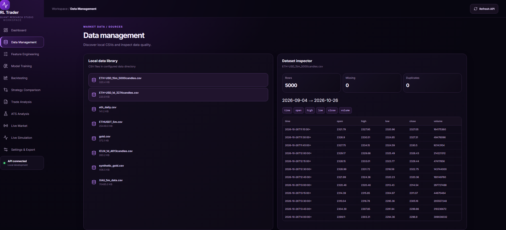
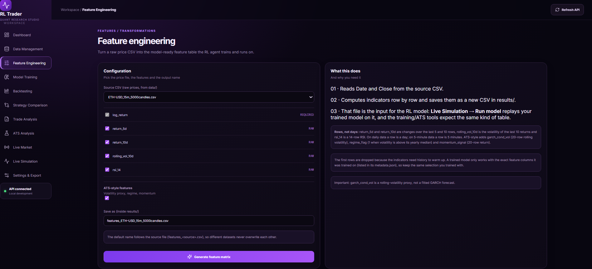
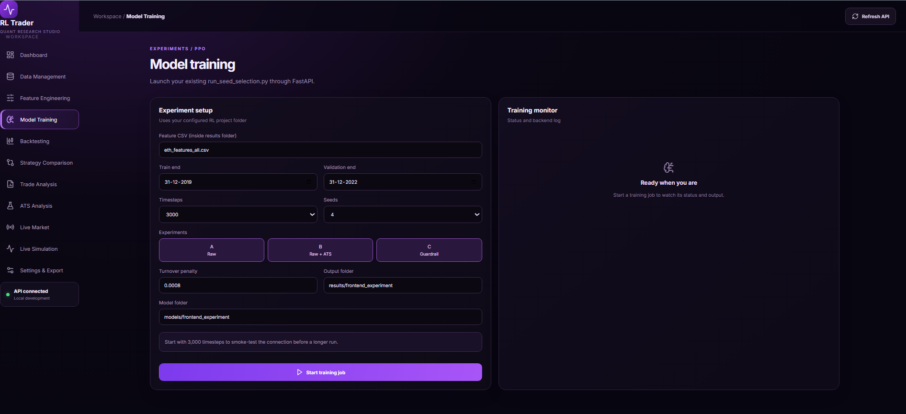
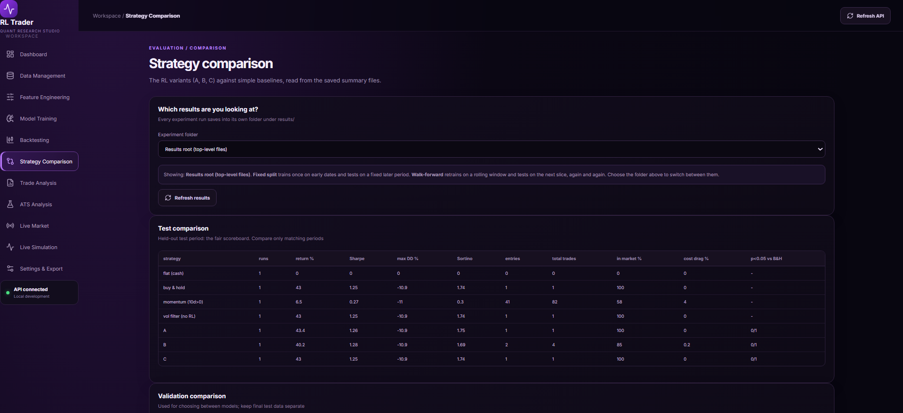
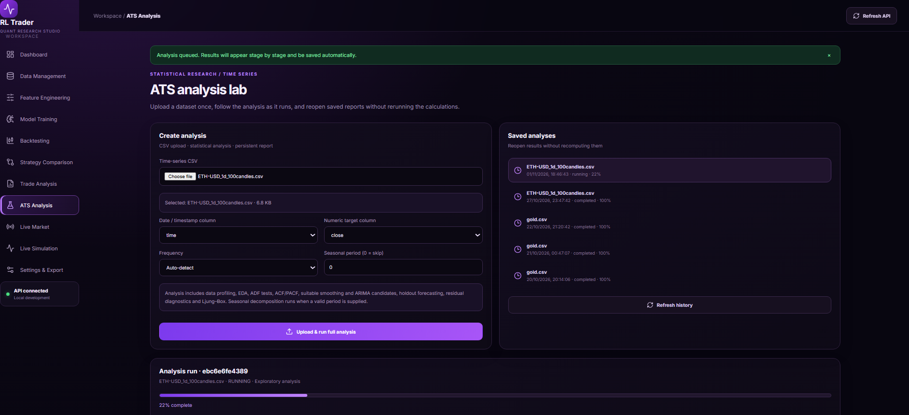
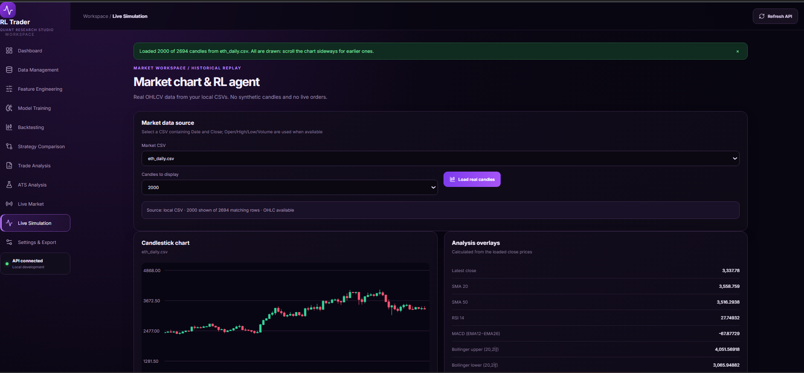
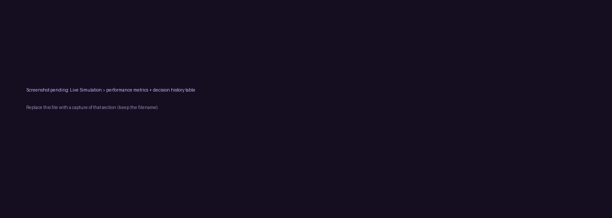
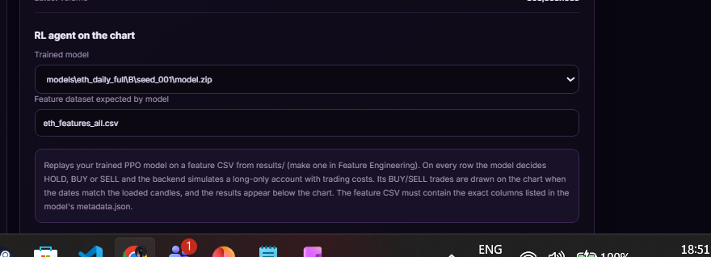

# AlgoTrade-RL-ATS

**A quantitative research workspace combining Reinforcement Learning (RL) trading research with an Automated Time-Series (ATS) analysis lab.**

[GitHub Repository](https://github.com/DhruvMarwal/AlgoTrade-RL-ATS)

The project brings historical market-data inspection, feature engineering, Proximal Policy Optimization (PPO) experiments, backtesting, strategy comparison, trade diagnostics, historical policy replay and statistical time-series analysis into one local web application.

> **Research / demonstration software only.** The trading interface replays models on historical data. It does not place live orders, provide investment advice, or guarantee future performance. Backtest results depend on the dataset, time period, feature pipeline, model configuration and execution assumptions.

---

## Contents

- [Project Overview](#project-overview)
- [What the Application Does](#what-the-application-does)
- [Application Screenshots](#application-screenshots)
- [Architecture and Repository Structure](#architecture-and-repository-structure)
- [Requirements](#requirements)
- [Setup: Clone, Virtual Environment and Dependencies](#setup-clone-virtual-environment-and-dependencies)
- [Run the Frontend and Backend](#run-the-frontend-and-backend)
- [Using the Application](#using-the-application)
- [Market Data and Feature Engineering](#market-data-and-feature-engineering)
- [RL Environment and Strategy Variants](#rl-environment-and-strategy-variants)
- [Training Experiments](#training-experiments)
- [Walk-Forward Validation](#walk-forward-validation)
- [Training Logs, Action Logs and Saved Policies](#training-logs-action-logs-and-saved-policies)
- [Evaluation and Results](#evaluation-and-results)
- [Illustrative Experiment Results](#illustrative-experiment-results)
- [ATS Time-Series Analysis](#ats-time-series-analysis)
- [Where to Find Outputs](#where-to-find-outputs)
- [Troubleshooting](#troubleshooting)
- [Limitations](#limitations)

---

## Project Overview

AlgoTrade-RL-ATS is organised around two connected research areas.

### 1. RL Trader

The RL trading pipeline trains an agent to make sequential portfolio decisions from market observations. The agent observes a feature vector and portfolio state, chooses an action, receives a reward from the trading environment and updates its policy during training.

The research pipeline includes:

- Historical market-data preparation.
- Technical and statistical feature generation.
- PPO (Proximal Policy Optimization) training.
- Multiple strategy/feature variants and random seeds.
- Validation-based seed selection.
- Fixed train/validation/test evaluation.
- Walk-forward evaluation across successive test periods.
- Saved policy, scaler and metadata files.
- Action-level and training-level logging.
- Interactive historical replay in the frontend.

### 2. ATS Analysis Lab

The ATS module accepts a time-series CSV and runs a staged statistical analysis. The interface supports data profiling, exploratory analysis, stationarity tests, transformations, temporal structure and lag analysis, baseline forecasting, exponential smoothing candidates, ARIMA model comparison, forecast/model selection and residual diagnostics.

Completed reports can be reopened from the application without rerunning the analysis.

---

## What the Application Does

The web application provides the following workspace modules:

| Module | Purpose |
|---|---|
| Dashboard | Overview of the research workspace, data availability and evaluation status. |
| Data Management | Discovers local CSV datasets and previews their columns, row counts, missing values, duplicates and date range. |
| Feature Engineering | Builds model-ready feature matrices from selected raw market data. |
| Model Training | Launches configured PPO experiments and displays training status/output. |
| Backtesting | Browses saved result files, previews CSVs and charts, and downloads artifacts. |
| Strategy Comparison | Compares RL variants against baselines using saved validation and test summaries. |
| Trade Analysis | Examines requested actions, executed actions, actual entries/exits and per-step action history. |
| ATS Analysis | Uploads time-series CSVs, runs statistical analysis and reopens saved reports. |
| Live Market | Provides the market workspace for the application's configured market-data workflow. |
| Live Simulation | Replays a compatible saved policy on a selected historical market window and visualises decisions. |
| Settings & Export | Provides application configuration and export-related controls. |

---

## Application Screenshots

The screenshots below are stored in [`docs/images/`](docs/images/). They are embedded using relative paths, so they render on GitHub when the `docs` folder is committed with this README.

### Dashboard

The landing page brings the research workflow together and provides shortcuts to data, feature engineering, training and backtesting.


### Data Management

The local data library lists available CSV files. The dataset inspector displays the selected file's row count, missing values, duplicates, date range, columns and a sample of records.



### Feature Engineering

Select a source CSV, choose features, enable additional ATS-style features and save a generated feature matrix under `results/`.



### Model Training

Configure the feature CSV, train/validation cut-offs, timestep budget, number of seeds, strategy variants, turnover penalty and output directories. The training monitor displays the job status and backend output.



### Backtesting and Saved Artifacts

Browse experiment outputs saved under `results/`. CSV files can be previewed as tables and chart artifacts can be opened as images.


### Strategy Comparison

Compare the saved RL variants with simple baselines. Select an experiment folder to inspect the corresponding validation and held-out test summaries.



### Trade Analysis

Inspect requested versus executed HOLD/BUY/SELL actions, actual position entries and exits, redundant actions, time spent long or flat, and guardrail overrides.


### ATS Analysis Lab

Upload a time-series CSV, select its timestamp and numeric target columns, set the frequency/seasonal period and start the staged analysis. Saved analyses can be reopened later.



### ATS Report Progress

The report interface shows the analysis stages and their completion status.


### ATS Report Results

The completed report presents statistical findings, forecast/model comparison, residual diagnostics and a final interpretation with limitations.


### Live Simulation: Historical Candles and Indicators

Choose a local market CSV and the number of candles to load. The chart displays historical OHLCV candles and analytical overlays such as SMA, RSI, MACD and Bollinger Bands.



### Live Simulation: Performance and Decision History

The replay view reports performance metrics and a chronological decision table containing dates, actions, positions, rewards, equity and drawdown.



### Live Simulation: BUY/SELL Markers

The model's executed BUY/SELL trades are marked on the selected historical chart. The signal count depends on the selected policy, compatible feature matrix, historical window and execution rules. In the captured demonstration window, the selected policy generated one BUY signal.


### Live Simulation: Model and Feature Selection

The model selector is intended for choosing a saved policy compatible with the selected dataset. The feature CSV must match the exact feature inputs and preprocessing expected by that policy.



---

## Architecture and Repository Structure

The project is split into a React/Vite frontend and a Python FastAPI backend. The backend connects the interface to the existing research scripts, datasets, trained models and saved outputs.

```text
AlgoTrade-RL-ATS/
│
├── ats/                       # ATS/time-series analysis code
├── backend/                   # FastAPI application and API routes
│   └── app/
│       └── main.py             # Backend application entry point
├── data/                      # Raw and prepared market CSV datasets
├── features/                  # Feature-related code/configuration
├── frontend/                  # React + Vite user interface
│   ├── src/
│   ├── package.json
│   └── ...
├── models/                    # Trained policies, scalers, metadata, checkpoints
├── outputs_ppo_logger/        # PPO logger outputs and logger checkpoint
├── results/                   # Feature matrices, metrics, logs, plots and reports
├── archives/                  # Preserved earlier experiment snapshots
├── tests/                     # Automated tests
│
├── build_5m_features.py
├── build_eth_daily_features.py
├── download_eth.py
├── evaluate_saved_model.py
├── evaluation.py
├── fix_eth_data.py
├── plotting.py
├── preflight_seed_pipeline.py
├── prepare_external_features.py
├── run_experiments.py
├── run_q_learning.py
├── run_seed_selection.py
├── test_daily_model_on_5m.py
├── test_saved_eth_policy.py
├── train_policy_logger.py
├── requirements.txt
├── README.md
└── .gitignore
```

The exact contents of the data, model and results folders evolve as new experiments are run. Existing experiment folders are retained so earlier runs can be compared and reproduced where their inputs and configuration are available.

---

## Requirements

- Windows 10/11 (commands below use PowerShell).
- Python 3.10+ recommended; use the Python version compatible with the installed project dependencies.
- Node.js and npm (a current Node.js LTS release is recommended).
- Git.
- Sufficient disk space for market CSVs, trained model checkpoints and experiment outputs.

Python dependencies are listed in `requirements.txt`. Frontend dependencies are listed in `frontend/package.json`.

---

## Setup: Clone, Virtual Environment and Dependencies

### 1. Clone the repository

Open PowerShell in the directory where you want the project:

```powershell
git clone https://github.com/DhruvMarwal/AlgoTrade-RL-ATS.git
cd AlgoTrade-RL-ATS
```

### 2. Create a Python virtual environment

```powershell
py -m venv .venv
```

### 3. Activate the virtual environment

```powershell
Set-ExecutionPolicy -Scope Process -ExecutionPolicy RemoteSigned
.\.venv\Scripts\Activate.ps1
```

The terminal prompt should now begin with `(.venv)`.

If PowerShell activation is unavailable, use Command Prompt instead:

```bat
.venv\Scripts\activate.bat
```

### 4. Upgrade pip and install Python requirements

Run this from the repository root, with the virtual environment activated:

```powershell
python -m pip install --upgrade pip
pip install -r requirements.txt
```

### 5. Install frontend dependencies

Open a second terminal, move to the frontend folder and install npm packages:

```powershell
cd frontend
npm install
```

Do not upload `.venv/`, `node_modules/`, local `.env` files or credentials to GitHub. If the backend needs environment variables, create your own local `.env` using the safe placeholder names in `backend/.env.example` (if provided).

---

## Run the Frontend and Backend

Run the frontend and backend in **two separate terminals**. Keep both terminals open while using the application.

### Terminal 1 — Start the frontend

From the repository root:

```powershell
cd frontend
npm run dev
```

The Vite development server should print a local URL, normally:

```text
http://127.0.0.1:5173/
```

Open that URL in your browser.

### Terminal 2 — Start the backend

From a second PowerShell terminal, navigate to the repository root. Activate the virtual environment if it is not already active, then start FastAPI:

```powershell
Set-ExecutionPolicy -Scope Process -ExecutionPolicy RemoteSigned
.\.venv\Scripts\Activate.ps1
cd backend
uvicorn app.main:app --port 8001 --reload
```

The backend should start at:

```text
http://127.0.0.1:8001
```

The terminal should show `Application startup complete.`. The frontend makes API requests to the local backend; keep both servers running.

To stop either server, focus its terminal and press `Ctrl + C`.

---

## Using the Application

A recommended end-to-end walkthrough is:

1. **Dashboard:** Confirm that the API is connected.
2. **Data Management:** Select a dataset and inspect its schema, date range, missing values and duplicates.
3. **Feature Engineering:** Generate a feature matrix suitable for the intended asset/timeframe and model.
4. **Model Training:** Configure a fixed-split experiment or use the training script from PowerShell.
5. **Backtesting:** Browse saved CSV summaries, logs and plots.
6. **Strategy Comparison:** Compare variants and baselines on matching evaluation periods.
7. **Trade Analysis:** Understand the actions the agent requested and what the environment actually executed.
8. **Live Simulation:** Select the correct market CSV, historical candle window, compatible model and feature matrix; replay the policy and inspect the chart markers and metrics.
9. **ATS Analysis:** Upload a time-series CSV and inspect the generated report.

### Important: Model and dataset must match

The Live Simulation model selector should be used to select a policy trained for the relevant dataset/feature configuration. A trained policy expects a particular number, order and meaning of input columns. Use its saved `metadata.json` and `scaler.pkl` together with `model.zip`.

Do not assume that a model trained on one asset/timeframe can be applied to another asset/timeframe just because both datasets are CSV files.

---

## Market Data and Feature Engineering

### Input market data

The repository contains multiple historical datasets, including Gold (XAU), Ethereum (ETH), ICLN and prepared/synthetic data used in specific experiments. Inspect the actual files under `data/` before choosing one; file names and timeframes matter.

Typical market columns include timestamp/date and OHLCV values:

- `open`: opening price for the candle.
- `high`: highest price during the candle.
- `low`: lowest price during the candle.
- `close`: closing price for the candle.
- `volume`: traded volume, when available.

### Feature generation

The feature-generation scripts and frontend feature engineering module convert raw prices into numerical observations for the model. Examples used across the project include:

| Feature | Meaning |
|---|---|
| `log_return` | Logarithmic change in price between observations. |
| `return_5d` | Price return over five rows/observations. |
| `return_10d` | Price return over ten rows/observations. |
| `rolling_vol_10d` | Rolling volatility over ten observations. |
| `rsi_14` | Relative Strength Index over fourteen observations. |
| `garch_cond_vol` | Volatility proxy used by the relevant feature pipeline; in the documented pipeline this is a rolling-volatility proxy, not necessarily a fitted GARCH forecast. |
| `regime_flag` | Encoded market-volatility regime. |
| `momentum_signal` | Momentum-based signal/feature. |

The exact feature set depends on the experiment and is recorded in the model metadata. The list above is an example, not a claim that every dataset uses every feature.

### Why features differ across assets and timeframes

A fixed feature list is not automatically appropriate for every dataset:

1. **Timeframe changes the meaning of a lookback.** Ten rows of 5-minute candles represent 50 minutes; ten daily observations represent roughly ten trading sessions.
2. **Assets behave differently.** Gold, crypto and equity/ETF data can have different volatility, liquidity, trading hours and price dynamics.
3. **Data availability differs.** Some datasets have different columns, frequencies, missing periods and history lengths.
4. **Rolling indicators need warm-up history.** Initial rows may be dropped until enough observations exist to calculate rolling indicators.
5. **A trained model has a fixed input schema.** The model must receive the same feature columns in the same order and use the corresponding fitted scaler.

### Frontend feature engineering workflow

1. Select the raw source CSV.
2. Select the features required for the experiment.
3. Enable additional volatility/regime/momentum features when appropriate.
4. Choose an output filename.
5. Generate the feature matrix.
6. Use that exact output as the training input and preserve it for later replay/evaluation.

Generated feature matrices are saved under `results/` (for example, `results/features_all.csv` or dataset-specific feature files). Check the selected output path shown by the interface or the command used for the experiment.

---

## RL Environment and Strategy Variants

The research scripts support three experiment variants labelled **A**, **B** and **C**. The labels are used consistently in training outputs and result folders. Their exact configuration should be checked in the current source code and experiment metadata before interpreting a run; do not infer a variant's behaviour from its letter alone.

The documented experiment output includes comparisons against simple baselines such as:

- Flat/cash.
- Buy and hold.
- Momentum (10-day return positive).
- Volatility filter (when produced by that experiment).

The environment uses a long-only position representation in the documented logs: the agent can be flat or hold a long position. The policy's requested action and the environment's executed action are logged separately because execution rules can make an action redundant or otherwise alter what happens.

A turnover penalty can be supplied during training to discourage excessive trading. The exact reward, transaction-cost and guardrail implementation is defined by the training/environment code and should be read alongside the experiment metadata.

---

## Training Experiments

Run training commands from the **repository root**, with the Python virtual environment activated.

### A. Quick smoke test — 3,000 timesteps

Use a small run first to check that the feature CSV, environment, training script and output paths work before launching a longer experiment. The frontend training screen also recommends starting with a small smoke-test budget.

The command-line training scripts accept a `--timesteps` argument. A smoke-test command using the same fixed-split setup is:

```powershell
python run_seed_selection.py --features_csv results/features_all.csv --train_end 2019-12-31 --valid_end 2022-12-31 --timesteps 3000 --seeds 1 --turnover_penalty 0.0008 --checkpoint_freq 1000 --experiments A B C --out_dir results/smoke_test --model_dir models/smoke_test
```

### B. Fixed-split experiment — 60,000 timesteps

This is the documented fixed-split run used for the result summary later in this README:

```powershell
python run_seed_selection.py --features_csv results/features_all.csv --train_end 2019-12-31 --valid_end 2022-12-31 --timesteps 60000 --seeds 5 --turnover_penalty 0.0008 --checkpoint_freq 10000 --experiments A B C --out_dir results/fixed_split --model_dir models/fixed_split
```

The recorded chronological split was:

| Split | Date range | Rows |
|---|---|---:|
| Train | 2010-02-03 to 2019-12-31 | 2,492 |
| Validation | 2020-01-02 to 2022-12-30 | 756 |
| Test | 2023-01-03 to 2024-12-31 | 503 |

The script trained each of A, B and C using five seeds, selected seeds using validation results and then evaluated the selected strategy runs on the held-out test period. The test set should not be used repeatedly to tune the model.

### C. Walk-forward experiment — 60,000 timesteps

The following is the documented walk-forward command:

```powershell
python run_experiments.py --features_csv results/features_all.csv --walkforward --wf_first_test_year 2016 --wf_fold_years 1 --wf_min_train_years 5 --timesteps 60000 --seeds 4 --turnover_penalty 0.0008 --experiments A B C --out_dir results/walkforward
```

This configuration produced nine annual test folds, beginning with 2016 and continuing through 2024. Each fold trains using data available before that fold's test year and evaluates on the next annual slice. This is intended to examine how performance changes across different market periods.

### D. Change the timestep budget, seeds and variants

The main experiment controls are:

| Argument | Meaning |
|---|---|
| `--timesteps` | Number of environment timesteps used for training each run. |
| `--seeds` | Number of random seeds/runs for each selected experiment variant. |
| `--checkpoint_freq` | How frequently intermediate model checkpoints are saved (used by `run_seed_selection.py`). |
| `--experiments A B C` | Selects which experiment variants to run. |
| `--turnover_penalty` | Trading-turnover penalty parameter. |
| `--train_end` | End date of the training split. |
| `--valid_end` | End date of the validation split. |
| `--out_dir` | Directory for experiment result artifacts. |
| `--model_dir` | Directory for trained model artifacts. |

For example, to run 30,000 timesteps with three seeds and store it separately, change the relevant values and use new output folders:

```powershell
python run_seed_selection.py --features_csv results/features_all.csv --train_end 2019-12-31 --valid_end 2022-12-31 --timesteps 30000 --seeds 3 --turnover_penalty 0.0008 --checkpoint_freq 5000 --experiments A B C --out_dir results/fixed_split_30k --model_dir models/fixed_split_30k
```

For a 120,000-timestep run, use `--timesteps 120000` and a new pair of output folders. Do not reuse an existing output directory unless you intentionally want to continue/overwrite artifacts according to the script's behaviour.

> The 3,000- and 30,000-timestep commands above are suggested configurations derived from the documented command pattern. The 60,000-timestep fixed-split and walk-forward commands are the exact commands recorded for the project runs.

### E. Training a PPO logger run

The repository also contains `train_policy_logger.py` and an `outputs_ppo_logger/` directory with logger artifacts. The inventory confirms these outputs:

```text
outputs_ppo_logger/
├── action_log.csv
├── run_metadata.json
├── training_updates.csv
└── ppo_gold_logger.zip
```

The exact CLI arguments for `train_policy_logger.py` are not included here because they should be taken from the script's current `--help` output rather than guessed. To inspect them:

```powershell
python train_policy_logger.py --help
```

Then run the script with the arguments shown by that help output. This logger workflow is separate from the fixed-split `run_seed_selection.py` command above.

---

## Walk-Forward Validation

A fixed split trains once on an earlier period, chooses a model using validation data and evaluates on a held-out test period. Walk-forward validation repeats the process across successive time periods.

In the recorded run:

- First test year: 2016.
- Test fold length: one year.
- Minimum training history: five years.
- Training budget: 60,000 timesteps.
- Seeds per variant: four.
- Variants: A, B and C.
- Output directory: `results/walkforward/`.

Walk-forward evaluation is useful because market behaviour changes over time. A strategy that performs well in one period may behave differently in another. Inspect per-fold results rather than relying only on a single aggregate score.

---

## Training Logs, Action Logs and Saved Policies

The project preserves more than the final policy file. It saves intermediate checkpoints, fitted preprocessing objects, metadata, evaluation logs and plots so that runs can be inspected later.

### Model directory contents

A typical trained seed folder can contain:

```text
models/<experiment>/<variant>/seed_<id>/
├── model.zip                 # Saved PPO policy
├── scaler.pkl                # Fitted feature scaler/preprocessor
├── metadata.json             # Input columns and run configuration
├── checkpoints/
│   ├── ppo_<step>_steps.zip  # Intermediate policy checkpoints
├── valid_daily_log.csv       # Validation decisions/results
├── test_daily_log.csv        # Held-out test decisions/results
├── valid_equity.png          # Validation equity plot
└── test_equity.png           # Test equity plot
```

The exact layout can vary between experiment folders. Some folders also contain a `selected/` directory with the seed selected using validation performance.

### Important files to inspect

| File | What it contains |
|---|---|
| `model.zip` | Trained PPO policy parameters. |
| `scaler.pkl` | Fitted feature scaling/preprocessing object used with the model. |
| `metadata.json` | Model input feature names/order and relevant training configuration. |
| `checkpoints/ppo_*_steps.zip` | Intermediate snapshots of the policy at checkpoint intervals. |
| `training_updates.csv` | PPO training-update/logger information, when generated by the logger workflow. |
| `action_log.csv` | Per-step action logging from the PPO logger workflow. |
| `seed_action_history.csv` | Action-level history across experiment seeds/splits. |
| `training_progress.csv` | Progress information captured during experiment training. |
| `runs.csv` | Run-level experiment records. |
| `summary_valid.csv` | Validation summary metrics. |
| `summary_test.csv` | Held-out test summary metrics. |
| `results_table.md` | Human-readable experiment comparison. |
| `*_equity*.png`, `backtest_*.png` | Equity curves and backtest visualisations. |

### Action values and interpretation

In the saved action-history CSVs, action values are encoded numerically. In the documented three-action setup, the common mapping is:

| Value | Action |
|---:|---|
| 0 | HOLD |
| 1 | BUY |
| 2 | SELL |

Always check the specific logger/environment mapping before interpreting a different CSV, because another script or output format may use a different encoding.

### Requested versus executed actions

The trade diagnostics distinguish:

- `requested_action`: what the policy asked the environment to do.
- `executed_action`: what the environment actually did after applying its rules.
- `actual_entries` / `actual_exits`: real position changes.
- `redundant_actions`: requests that did not change the position, such as BUY while already long.
- `long_days` / `flat_days`: time spent holding a long position versus remaining in cash.
- `guardrail_overrides`: occasions when a safety/guardrail rule changed the requested action.

This distinction matters: a model may request BUY many times without producing the same number of new trades.

---

## Evaluation and Results

The experiment pipeline reports multiple performance and trading-activity measures.

| Metric | Interpretation |
|---|---|
| Return (%) | Percentage change in portfolio value over the evaluation period. |
| Sharpe ratio | Risk-adjusted return relative to return variability. |
| Maximum drawdown (%) | Largest peak-to-trough decline in portfolio value. |
| Sortino ratio | Risk-adjusted return using downside variability. |
| Entries | Number of position entries. |
| Total trades | Number of executed trade actions as defined by the evaluation script. |
| In-market (%) | Percentage of evaluation observations spent invested. |
| Cost drag (%) | Estimated performance impact of transaction costs. |
| p<0.05 vs B&H | Statistical comparison against buy-and-hold when reported by the evaluation pipeline. |

For a fair comparison, compare strategies over the same test period and with the same assumptions. Validation results are for model/seed selection; the held-out test period is for final evaluation.

---

## Illustrative Experiment Results

The following figures are from the recorded 60,000-timestep fixed-split experiment using `results/features_all.csv`, train end `2019-12-31`, validation end `2022-12-31`, five seeds and turnover penalty `0.0008`.

### Held-out test results

| Strategy | Runs | Return (%) | Sharpe | Max drawdown (%) | Sortino | In market (%) | Cost drag (%) |
|---|---:|---:|---:|---:|---:|---:|---:|
| Flat (cash) | 1 | 0.0 | 0.00 | 0.0 | 0.00 | 0 | 0.0 |
| Buy & hold | 1 | 43.0 | 1.25 | -10.9 | 1.74 | 100 | 0.0 |
| Momentum (10d > 0) | 1 | 6.5 | 0.27 | -11.0 | 0.30 | 58 | 4.0 |
| Volatility filter (no RL) | 1 | 43.0 | 1.25 | -10.9 | 1.74 | 100 | 0.0 |
| A | 5 | 34.3 ± 14.6 | 1.05 ± 0.36 | -10.9 ± 0.0 | 1.41 ± 0.56 | 88 ± 17 | 0.2 ± 0.2 |
| B | 5 | 17.1 ± 16.8 | 0.60 ± 0.70 | -8.6 ± 2.4 | 0.77 ± 0.71 | 48 ± 35 | 0.4 ± 0.4 |
| C | 5 | 14.7 ± 12.4 | 0.45 ± 0.74 | -6.6 ± 3.4 | 0.64 ± 0.53 | 46 ± 38 | 0.6 ± 0.4 |

### Validation results

| Strategy | Runs | Return (%) | Sharpe | Max drawdown (%) | Sortino |
|---|---:|---:|---:|---:|---:|
| Flat (cash) | 1 | 0.0 | 0.00 | 0.0 | 0.00 |
| Buy & hold | 1 | 19.7 | 0.34 | -21.2 | 0.45 |
| Momentum (10d > 0) | 1 | -12.6 | -0.35 | -26.4 | -0.34 |
| Volatility filter (no RL) | 1 | 1.7 | 0.04 | -24.6 | 0.04 |
| A | 5 | 16.2 ± 7.9 | 0.32 ± 0.13 | -17.7 ± 3.7 | 0.37 ± 0.18 |
| B | 5 | 14.7 ± 5.5 | 0.51 ± 0.23 | -12.4 ± 8.0 | 0.39 ± 0.12 |
| C | 5 | -2.4 ± 5.0 | -0.09 ± 0.19 | -20.7 ± 5.0 | -0.05 ± 0.12 |

### How to interpret this run

- Variant A had the highest average held-out test return among A, B and C in this particular run: `34.3% ± 14.6%`.
- Buy-and-hold returned `43.0%` in the same test period, so the RL variants did not outperform buy-and-hold on average by return in this experiment.
- Variant B had a lower average test return (`17.1%`) but a less negative average maximum drawdown (`-8.6%`) than A (`-10.9%`) in the reported table.
- Validation-based seed selection selected different seeds for A, B and C. The selected seed is not necessarily the seed with the highest test return; test data is kept separate from selection.
- These figures describe one experiment configuration and historical period. They are not evidence of guaranteed future profitability or a universal ranking of the variants.

### Selected seeds from validation

| Variant | Selected seed | Validation return (%) | Validation Sharpe | Validation max drawdown (%) |
|---|---:|---:|---:|---:|
| A | 4 | 24.41 | 0.472 | -17.90 |
| B | 4 | 9.25 | 0.796 | -2.89 |
| C | 1 | 2.24 | 0.062 | -15.93 |

### Where to inspect these results

```text
results/fixed_split/
├── runs.csv
├── seed_summary.csv
├── episode_starts.csv
├── training_progress.csv
├── seed_action_history.csv
├── summary_test.csv
├── summary_valid.csv
├── results_table.md
├── test_equity_curves.png
├── backtest_A_seed0.png
├── backtest_B_seed0.png
└── backtest_C_seed0.png

models/fixed_split/
└── selected/
    ├── A/
    ├── B/
    └── C/
```

The selected model folders contain the saved policy, scaler, metadata and related evaluation artifacts. Exact contents depend on the run.

---

## ATS Time-Series Analysis

The ATS Analysis module provides a guided workflow for analysing an uploaded time-series CSV.

### Inputs

- Time-series CSV file.
- Timestamp/date column.
- Numeric target column.
- Frequency (auto-detect or a selected frequency, depending on the dataset).
- Seasonal period (`0` skips seasonal decomposition when supported by the workflow).

### Analysis stages shown in the application

- Data quality and profile.
- Exploratory analysis.
- Stationarity and transformations.
- Temporal structure and lags.
- Baseline forecast.
- Exponential smoothing candidates.
- ARIMA model comparison.
- Forecast and model selection.
- Residual diagnostics, including Ljung-Box where applicable.

### Saved reports

Analysis runs are stored by the backend and can be reopened from the Saved Analyses section. The application can display progress and the completed report, including selected model, holdout error metrics, diagnostic tables and a final statistical interpretation.

Forecast accuracy is not equivalent to trading profitability. A statistical time-series forecast and an RL trading policy answer different questions and should be evaluated separately.

---

## Where to Find Outputs

Use these paths when inspecting the project after a run:

| What you want to inspect | Where to look |
|---|---|
| Raw market CSVs | `data/` |
| Generated feature matrices | `results/` (for example `results/features_all.csv`) and feature-specific output files |
| Trained PPO policies | `models/<experiment>/` |
| Selected policies | `models/<experiment>/selected/` |
| Individual seed policies | `models/<experiment>/<A-or-B-or-C>/seed_<id>/` |
| Intermediate checkpoints | `models/<experiment>/<variant>/seed_<id>/checkpoints/` |
| Model feature schema/config | Corresponding `metadata.json` beside the model |
| Fitted scaler | Corresponding `scaler.pkl` beside the model |
| Validation/test action logs | `models/.../valid_daily_log.csv`, `models/.../test_daily_log.csv` where generated |
| Run summaries | `results/<experiment>/runs.csv`, `seed_summary.csv` |
| Test and validation summaries | `results/<experiment>/summary_test.csv`, `summary_valid.csv` |
| Per-step action history | `results/<experiment>/seed_action_history.csv` |
| Training progress | `results/<experiment>/training_progress.csv` |
| Equity/backtest plots | `results/<experiment>/*.png` |
| Walk-forward outputs | `results/walkforward/` or the configured walk-forward output folder |
| PPO logger artifacts | `outputs_ppo_logger/` |
| ATS reports/uploads | `results/ats_reports/` and `results/ats_uploads/` |
| Archived experiment snapshots | `archives/` |

The Backtesting and Trade Analysis pages can also be used to browse many of these saved artifacts without opening them manually in File Explorer.

---

## Troubleshooting

### PowerShell will not activate the virtual environment

Run this in the current PowerShell process:

```powershell
Set-ExecutionPolicy -Scope Process -ExecutionPolicy RemoteSigned
.\.venv\Scripts\Activate.ps1
```

### `uvicorn` is not recognised or a Python module is missing

Confirm that `(.venv)` appears in the terminal, then reinstall the requirements:

```powershell
python -m pip install --upgrade pip
pip install -r requirements.txt
```

### Frontend packages are missing

From the `frontend/` folder:

```powershell
npm install
npm run dev
```

### Frontend loads but API is disconnected

- Confirm the backend terminal shows `Application startup complete.`.
- Confirm the backend is running on port `8001`.
- Confirm the frontend is running on port `5173`.
- Check the browser console and backend terminal for API errors.

### Model does not appear or cannot replay

- Confirm the model file exists under `models/`.
- Confirm its `metadata.json` and `scaler.pkl` are present.
- Select the feature CSV expected by the model.
- Confirm feature names, order, timeframe and preprocessing match the training metadata.
- Confirm the selected market CSV covers the dates being replayed.

### Training output is saved somewhere unexpected

Check the `--out_dir` and `--model_dir` values in the command. Relative paths are resolved from the working directory where the script is launched; run training commands from the repository root.

---

## Limitations

- The Live Simulation module is a historical replay workflow, not a broker-connected live execution system.
- Historical replay does not by itself model all real-world execution effects, such as intrabar fills, latency, liquidity constraints and slippage.
- Results are sensitive to asset, timeframe, feature definitions, training period, random seed, transaction costs and evaluation assumptions.
- A model must only be used with the input feature schema and scaler it was trained with.
- Technical indicators displayed as chart overlays are not necessarily all inputs to the RL policy.
- A favourable historical backtest does not guarantee future returns.
- ATS forecast performance does not imply trading profitability.
- Uploaded ATS data and saved reports may contain sensitive information; do not publish personal or confidential datasets in a public repository.

---

## 👤 Author

**Your Name**
- GitHub: [Dhruv Marwal](https://github.com/DhruvMarwal) , [Priyanshu Jha](https://github.com/Priyanshu0423) , [Shivang Jain](https://github.com/Xopse)
- LinkedIn: [Dhruv Marwal](https://linkedin.com/in/dhruvmarwal) , [Priyanshu Jha](https://linkedin.com/in/priyanshujha-) , [Shivang Jain](https://linkedin.com/in/shivang-jain-69602132a)

---
