# AlgoTrade-RL-ATS
### Reinforcement Learning-Based Algorithmic Trading & Applied Time Series Analysis

An integrated project combining a Reinforcement Learning (RL) trading research platform with an Applied Time Series (ATS) analysis lab, supported by a web dashboard (React frontend + FastAPI backend).

The RL Trader component uses **Proximal Policy Optimization (PPO)** to learn trading decisions from historical market data. Instead of simply predicting whether a price will rise or fall, the agent learns when to remain in cash, enter a long position, or exit an existing position.

The project includes historical data processing, feature engineering, PPO training, experiment comparison, model selection, saved-policy evaluation, trade logging, backtesting, historical replay and performance visualisation.

> **Disclaimer:** RL Trader is a historical trading simulation and research pipeline. It does not place real financial orders. Historical performance does not guarantee future returns.

---

## Table of Contents

1. [Project Overview](#1-project-overview)
2. [Key Features](#2-key-features)
3. [How the RL Trading System Works](#3-how-the-rl-trading-system-works)
4. [System Architecture](#4-system-architecture)
5. [Repository Structure](#5-repository-structure)
6. [Installation and Environment Setup](#6-installation-and-environment-setup)
7. [Running the Application](#7-running-the-application)
8. [Preparing the Trading Features](#8-preparing-the-trading-features)
9. [Training the PPO Agent](#9-training-the-ppo-agent)
10. [Training with Different Timestep Budgets](#10-training-with-different-timestep-budgets)
11. [Fixed-Split vs Walk-Forward Training](#11-fixed-split-vs-walk-forward-training)
12. [Action Logging and Training Monitoring](#12-action-logging-and-training-monitoring)
13. [Saving and Loading Trained Policies](#13-saving-and-loading-trained-policies)
14. [Evaluating Trained Models](#14-evaluating-trained-models)
15. [Experimental Results](#15-experimental-results)
16. [Understanding Generated Files](#16-understanding-generated-files)
17. [Application Walkthrough](#17-application-walkthrough)
18. [ATS Module (Applied Time Series)](#18-ats-module-applied-time-series)
19. [Limitations and Future Improvements](#19-limitations-and-future-improvements)

---

# 1. Project Overview

Traditional algorithmic trading systems often rely on predefined rules or supervised learning models that predict future price movements.

However, predicting a price movement does not automatically determine the best trading action. A trading system must also consider:

- Whether it is currently holding an asset.
- Whether it should enter or exit a position.
- Transaction costs.
- Market volatility.
- Portfolio returns.
- Maximum drawdown and risk exposure.

This project explores the use of Reinforcement Learning to address the decision-making aspect of trading.

The PPO agent interacts with a custom trading environment, receives observations about market conditions, chooses an action, and receives a reward based on the resulting trading outcome.

The broader repository also includes an Applied Time Series (ATS) lab (stationarity tests, ACF/PACF, ARIMA, forecasting and residual diagnostics), so the project demonstrates both a quantitative trading research workflow and a web application.

### Project Scope

- Historical market data analysis.
- Feature engineering and preprocessing.
- Reinforcement Learning using PPO.
- Multiple experiment configurations (A, B and C).
- Multiple random seeds for robustness testing.
- Fixed chronological train/validation/test evaluation.
- Expanding-window walk-forward evaluation.
- Trading action and performance logging.
- Model checkpointing and saved-policy replay.
- Frontend and backend integration.
- ATS (Applied Time Series) analysis and saved reports.

---

# 2. Key Features

## RL Trader

| Feature | Description |
|---|---|
| PPO Agent | Learns trading decisions using Reinforcement Learning. |
| Custom Trading Environment | Simulates positions, transactions, rewards and portfolio equity. |
| Feature Engineering | Generates technical and statistical market indicators. |
| Experiments A/B/C | Compares basic, enhanced and guardrail-based configurations. |
| Multi-seed Training | Tests different random initialisations. |
| Walk-forward Evaluation | Evaluates performance across multiple chronological periods. |
| Action Logging | Records decisions, positions, returns and equity. |
| Model Checkpointing | Saves intermediate models during training. |
| Saved Policy Replay | Reloads trained models without retraining. |
| Performance Analytics | Generates returns, Sharpe ratio, drawdown and equity curves. |

## Web Application

The web application provides an interface for interacting with the project's backend and displaying trading and ATS functionality: data inspection, feature engineering, model training, backtesting, strategy comparison, trade diagnostics, ATS analysis and historical replay with BUY/SELL signals.

The frontend is built with React and Vite, while the backend uses FastAPI. Screenshots of every page are in [Section 17](#17-application-walkthrough).

---

# 3. How the RL Trading System Works

The trading pipeline follows these stages:

1. Historical market data is loaded.
2. Data is cleaned and sorted chronologically.
3. Technical and statistical features are generated.
4. Data is divided into training, validation and testing periods.
5. A RobustScaler is fitted using training data only.
6. The Trading Environment generates observations and executes actions.
7. The PPO agent learns through repeated interactions.
8. Multiple experiments and random seeds are trained.
9. Validation performance is used to select models.
10. Saved policies are evaluated on unseen test data.
11. Results, trading decisions and performance charts are generated.
12. A trained policy can be replayed on a selected historical window in the dashboard.

### Trading Actions

The agent has three discrete actions:

| Action | Value | Meaning |
|---|---:|---|
| HOLD | 0 | Maintain the current position. |
| BUY | 1 | Enter a long position. |
| SELL | 2 | Exit the long position and move to cash. |

The environment supports long/flat trading. It does not open short positions.

The system distinguishes between the action the policy **requested** and the action actually **executed** after environment rules are applied (for example BUY while already long is redundant, and the guardrail in Experiment C can override actions). The Trade Analysis page shows both.

### State Representation

The main ETH daily model uses eight scaled numerical features and the current portfolio position.

The nine-dimensional observation consists of:

- Log return.
- Five-row return.
- Ten-row return.
- Ten-row rolling volatility.
- RSI (Relative Strength Index).
- GARCH-style conditional volatility.
- Market regime flag.
- Momentum signal.
- Current position.

### Reward Calculation

The environment considers the next-period return, transaction costs and turnover penalty.

The agent is rewarded for profitable decisions and penalised for unfavourable outcomes and unnecessary position changes.

The environment also tracks portfolio equity and maximum drawdown.

### Why Features and Models Differ Across Datasets

Features and trained models are **not interchangeable across datasets**. Each dataset needs its own feature file and its own trained policy:

- **Windows are row-based, not time-based.** `return_5d`, `return_10d` and `rolling_vol_10d` look back 5 or 10 *rows*. On daily data that is 5 or 10 days; on 5-minute data it is 25 or 50 minutes. The same column name means a different market horizon.
- **Volatility differs by asset and timeframe.** Gold, ETH and a clean-energy ETF have very different volatility levels, so identical feature values mean different things.
- **`regime_flag`** is 1 when volatility is above its yearly median. That median depends on the dataset, so the regime boundary changes per asset.
- **`garch_cond_vol` is a rolling-volatility proxy** (20-row rolling volatility), not a fitted GARCH forecast.
- **The scaler is fitted per dataset.** A RobustScaler is fitted on that dataset's training period only, and a model only makes sense on data scaled the same way.
- **Column set and order are part of the model.** The network's input size and meaning depend on the exact columns in `metadata.json`. A model trained on 8 features cannot run on a 5-feature file.
- **Early rows are dropped** while indicators warm up, so usable length changes with the dataset.
- **Training budgets differ.** Faster timeframes have far more rows and often need more timesteps.

For this reason the application only offers a trained model together with the feature dataset it expects (for example `models/eth_daily_full/B/seed_001/model.zip` with `eth_features_all.csv`), which prevents running a policy on an incompatible representation.

### Visual: RL Pipeline

From raw prices to a model bundle, and how each stage feeds the next.

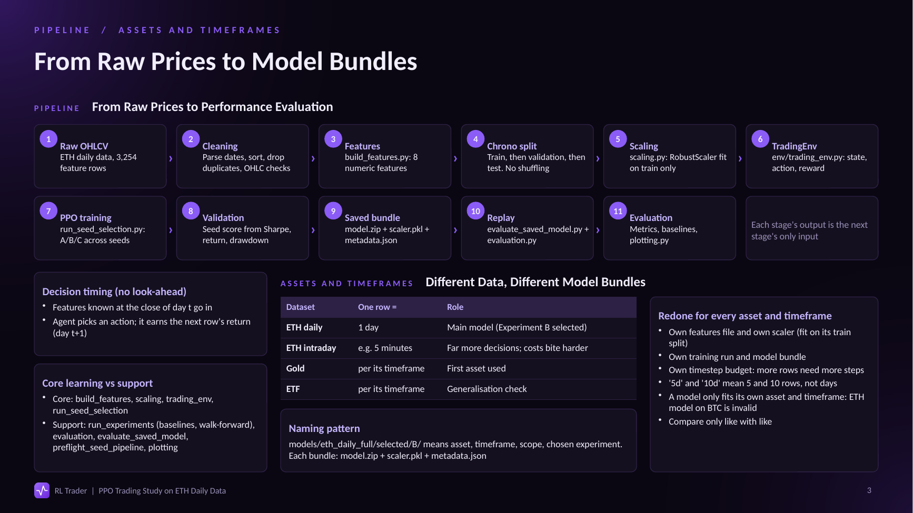

### Visual: Agent State, Action and Reward

How one row of the features file becomes an RL decision.

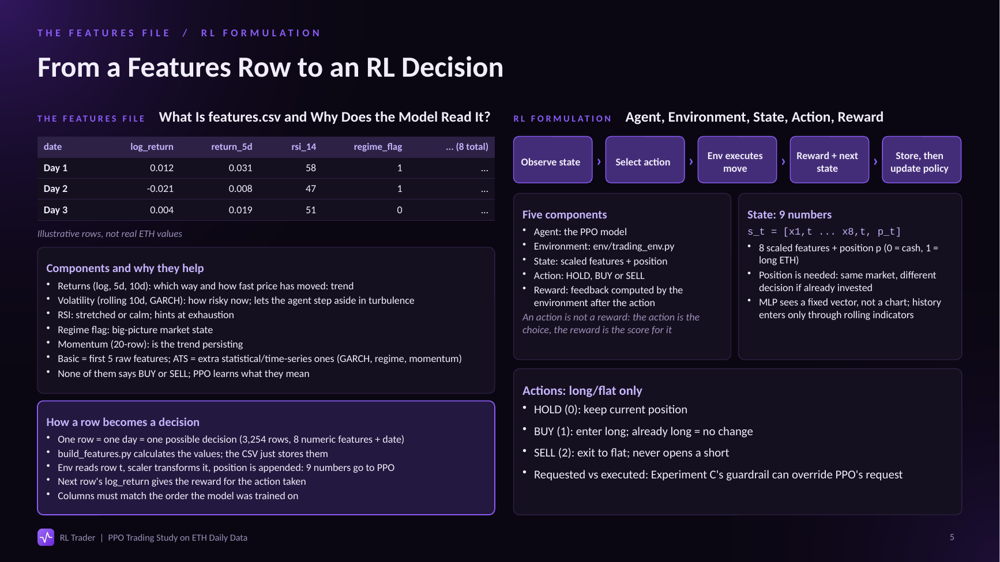

---

# 4. System Architecture

The repository contains three major layers:

### Frontend
- React-based user interface.
- Vite development server.
- Trading, evaluation and ATS pages.
- Communicates with backend API endpoints.

### Backend
- Python application using FastAPI.
- Handles API requests.
- Exposes health, model, training, results and ATS report endpoints.
- Connects the frontend with project functionality.

### Research and ML Pipeline
- Historical datasets.
- Feature generation and scaling.
- Custom trading environment.
- PPO model training.
- Experiment evaluation.
- Saved models and result logging.

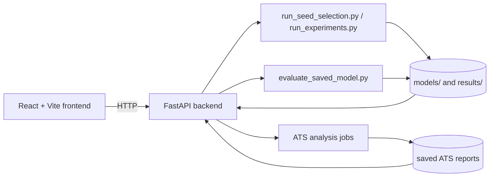

---

# 5. Repository Structure

The repository contains the following major directories:

```text
AlgoTrade-RL-ATS/
│
├── archives/
│   └── Previous experiment snapshots
│
├── ats/
│   └── ATS-related modules
│
├── backend/
│   ├── app/
│   │   └── main.py
│   ├── .env.example
│   └── ...
│
├── frontend/
│   ├── src/
│   │   ├── App.jsx
│   │   ├── LiveMarket.jsx
│   │   ├── main.jsx
│   │   └── styles.css
│   ├── package.json
│   └── ...
│
├── docs/
│   └── images/
│       └── Screenshots and diagrams used in this README
│
├── data/
│   ├── XAU_5m_data.csv
│   ├── ETHUSDT_5m.csv
│   ├── gold.csv
│   ├── eth_daily.csv
│   └── external/
│
├── features/
│   └── Generated feature datasets
│
├── models/
│   ├── fixed_split/
│   ├── 5m_experiment/
│   ├── eth_daily/
│   ├── eth_daily_full/
│   ├── seed_selection/
│   └── ...
│
├── outputs_ppo_logger/
│   ├── action_log.csv
│   ├── training_updates.csv
│   ├── run_metadata.json
│   └── ppo_gold_logger.zip
│
├── results/
│   ├── fixed_split/
│   ├── walkforward/
│   ├── walkforward_60k/
│   ├── seed_robustness_10/
│   ├── saved_model_evaluation/
│   ├── tradebot/
│   └── ...
│
├── tests/
│
├── build_5m_features.py
├── build_eth_daily_features.py
├── run_experiments.py
├── run_q_learning.py
├── run_seed_selection.py
├── train_policy_logger.py
├── evaluate_saved_model.py
├── evaluation.py
├── plotting.py
├── preflight_seed_pipeline.py
│
├── requirements.txt
├── README.md
└── .gitignore
```

The repository preserves previous experiments and model versions so that results can be inspected and compared.

---

# 6. Installation and Environment Setup

## Prerequisites

Install the following before running the project:

- Python (compatible with the installed project dependencies).
- Node.js and npm.
- Git.
- Visual Studio Code or another code editor.

### Step 1: Clone the repository

```powershell
git clone https://github.com/DhruvMarwal/AlgoTrade-RL-ATS.git

cd AlgoTrade-RL-ATS
```

### Step 2: Create a Python virtual environment

```powershell
python -m venv .venv
```

### Step 3: Activate the virtual environment

For Windows PowerShell:

```powershell
Set-ExecutionPolicy -Scope Process -ExecutionPolicy RemoteSigned

.\.venv\Scripts\Activate.ps1
```

After activation, the terminal should display:

```text
(.venv) PS C:\...\AlgoTrade-RL-ATS>
```

### Step 4: Upgrade pip

```powershell
python -m pip install --upgrade pip
```

### Step 5: Install Python dependencies

```powershell
pip install -r requirements.txt
```

### Step 6: Install frontend dependencies

```powershell
cd frontend

npm install
```

Return to the root directory when required:

```powershell
cd ..
```

**Important:** Keep the virtual environment active when running Python scripts or starting the backend.

---

# 7. Running the Application

The frontend and backend must run in separate terminals.

## A. Start the Backend

Open Terminal 1 in the repository root.

Activate the virtual environment if it is not already active:

```powershell
.\.venv\Scripts\Activate.ps1
```

Navigate to the backend:

```powershell
cd backend
```

Start the FastAPI server:

```powershell
uvicorn app.main:app --port 8001 --reload
```

### Expected Output

```text
INFO: Uvicorn running on http://127.0.0.1:8001
INFO: Waiting for application startup.
INFO: Application startup complete.
```

Backend URL:

http://127.0.0.1:8001

API documentation:

http://127.0.0.1:8001/docs

## B. Start the Frontend

Open Terminal 2 in the repository root.

Navigate to the frontend:

```powershell
cd frontend
```

Install dependencies if this is the first run:

```powershell
npm install
```

Start the Vite development server:

```powershell
npm run dev
```

### Expected Output

```text
VITE ready

Local: http://127.0.0.1:5173/
```

Open the frontend:

http://127.0.0.1:5173/

Keep both terminals running while using the application.

---

# 8. Preparing the Trading Features

The PPO training pipeline requires a chronological feature dataset.

For the fixed-split and walk-forward experiments documented below, the input file is:

```text
results/features_all.csv
```

This file contains the engineered numerical features used by the trading environment.

The project also includes feature-generation scripts:

```text
build_eth_daily_features.py
build_5m_features.py
build_q_learning.py
```

For the feature-generation scripts, check their available command-line arguments before execution:

```powershell
python build_eth_daily_features.py --help
python build_5m_features.py --help
```

The exact input and output arguments depend on the script configuration. Features can also be generated from the **Feature Engineering** page of the dashboard (see [Section 17](#feature-engineering)).

### Feature Engineering

The main daily ETH pipeline uses eight numerical features:

| Feature | Purpose |
|---|---|
| `log_return` | Recent price movement. |
| `return_5d` | Short-term price trend. |
| `return_10d` | Medium-term price trend. |
| `rolling_vol_10d` | Recent market volatility. |
| `rsi_14` | Relative Strength Index. |
| `garch_cond_vol` | Conditional volatility estimate (rolling-volatility proxy). |
| `regime_flag` | Market regime indicator. |
| `momentum_signal` | Momentum information. |

### Data Leakage Prevention

The pipeline preserves chronological order.

- Training data is used to fit the scaler.
- Validation data is used for model selection.
- Test data is reserved for final evaluation.
- The scaler is reused without refitting on future data.

This reduces the risk of look-ahead bias during evaluation.

---

# 9. Training the PPO Agent

<<<<<<< HEAD
**Your Name**
- GitHub: [Dhruv Marwal](https://github.com/DhruvMarwal) , [Priyanshu Jha](https://github.com/Priyanshu0423) , [Shivang Jain](https://github.com/Xopse)
- LinkedIn: [Dhruv Marwal](https://linkedin.com/in/dhruvmarwal) , [Priyanshu Jha](https://linkedin.com/in/priyanshujha-) , [Shivang Jain](https://linkedin.com/in/shivang-jain-69602132a)

---
=======
The primary training script is:

```text
run_seed_selection.py
```

It supports multiple experiment configurations and random seeds.

### Experiment Configurations

| Experiment | Configuration |
|---|---|
| A | Basic features: five numerical indicators, without guardrail. |
| B | Enhanced features: eight numerical indicators, without guardrail. |
| C | Enhanced features with a volatility-based trading guardrail. |

### Example: Fixed-Split Training

The following is the actual command used for the 60,000-timestep experiment:

```powershell
python run_seed_selection.py `
  --features_csv results/features_all.csv `
  --train_end 2019-12-31 `
  --valid_end 2022-12-31 `
  --timesteps 60000 `
  --seeds 5 `
  --turnover_penalty 0.0008 `
  --checkpoint_freq 10000 `
  --experiments A B C `
  --out_dir results/fixed_split `
  --model_dir models/fixed_split
```

### What Each Argument Means

| Argument | Meaning |
|---|---|
| `--features_csv` | Location of the input feature dataset. |
| `--train_end` | Last date included in training. |
| `--valid_end` | Last date included in validation. |
| `--timesteps` | Requested PPO training interaction budget. |
| `--seeds` | Number of random seeds per experiment. |
| `--turnover_penalty` | Penalty applied to unnecessary trading activity in the training reward. |
| `--checkpoint_freq` | Frequency for saving training checkpoints. |
| `--experiments` | Experiments to execute. |
| `--out_dir` | Directory where experiment results are stored. |
| `--model_dir` | Directory where trained model artifacts are stored. |

### Expected Dataset Split

The documented run produced:

| Dataset | Rows | Period |
|---|---:|---|
| Training | 2,492 | 2010-02-03 to 2019-12-31 |
| Validation | 756 | 2020-01-02 to 2022-12-30 |
| Testing | 503 | 2023-01-03 to 2024-12-31 |

The model is trained on the training partition, selected using validation performance and evaluated on the held-out test partition.

---

# 10. Training with Different Timestep Budgets

Different training budgets were explored to understand how additional PPO training affects performance.

A timestep represents one environment interaction: the agent observes the current state, selects an action, receives a reward and advances the environment.

The experiments used several budgets:

| Requested timesteps | Approximate actual steps | Purpose |
|---:|---:|---|
| 3,000 | 3,072 | Smoke test. |
| 30,000 | 30,720 | Initial learning signal. |
| 60,000 | 60,416 | Main documented experiment. |
| 90,000 | 90,112 | Check continued improvement. |
| 100,000 | 100,352 | Main runner default. |
| 120,000 | 120,832 | Investigate additional training and overfitting. |

The actual step count can exceed the requested budget because PPO collects complete rollouts.

The documented configuration uses 1,024 environment steps per rollout.

### Commands for Different Training Budgets

Use the same experiment setup and change the timestep budget and output directory.

**3,000 timesteps — Smoke test**

```powershell
python run_seed_selection.py --features_csv results/features_all.csv --train_end 2019-12-31 --valid_end 2022-12-31 --timesteps 3000 --seeds 5 --turnover_penalty 0.0008 --checkpoint_freq 1000 --experiments A B C --out_dir results/smoke_test --model_dir models/smoke_test
```

**30,000 timesteps**

```powershell
python run_seed_selection.py --features_csv results/features_all.csv --train_end 2019-12-31 --valid_end 2022-12-31 --timesteps 30000 --seeds 5 --turnover_penalty 0.0008 --checkpoint_freq 10000 --experiments A B C --out_dir results/training_30k --model_dir models/training_30k
```

**60,000 timesteps**

```powershell
python run_seed_selection.py --features_csv results/features_all.csv --train_end 2019-12-31 --valid_end 2022-12-31 --timesteps 60000 --seeds 5 --turnover_penalty 0.0008 --checkpoint_freq 10000 --experiments A B C --out_dir results/training_60k --model_dir models/training_60k
```

**90,000 timesteps**

```powershell
python run_seed_selection.py --features_csv results/features_all.csv --train_end 2019-12-31 --valid_end 2022-12-31 --timesteps 90000 --seeds 5 --turnover_penalty 0.0008 --checkpoint_freq 10000 --experiments A B C --out_dir results/training_90k --model_dir models/training_90k
```

**120,000 timesteps**

```powershell
python run_seed_selection.py --features_csv results/features_all.csv --train_end 2019-12-31 --valid_end 2022-12-31 --timesteps 120000 --seeds 5 --turnover_penalty 0.0008 --checkpoint_freq 10000 --experiments A B C --out_dir results/training_120k --model_dir models/training_120k
```

These are reproducible command patterns based on the documented 60k run. The smaller and larger budgets use the same configuration with changed budgets and output locations; run them independently to generate their corresponding results.

**Important:** A larger timestep budget does not automatically produce a better trading policy. Compare validation results and final test results rather than relying on training reward alone.

---

# 11. Fixed-Split vs Walk-Forward Training

The project uses two evaluation approaches.

## A. Fixed-Split Training

The dataset is divided into three chronological sections:

```text
TRAINING  →  VALIDATION  →  TESTING
```

This is used for initial model development and seed selection.

## B. Walk-Forward Evaluation

Walk-forward testing repeatedly trains on historical data and evaluates the next year.

The training window expands as time progresses.

### Actual Walk-Forward Command

```powershell
python run_experiments.py `
  --features_csv results/features_all.csv `
  --walkforward `
  --wf_first_test_year 2016 `
  --wf_fold_years 1 `
  --wf_min_train_years 5 `
  --timesteps 60000 `
  --seeds 4 `
  --turnover_penalty 0.0008 `
  --experiments A B C `
  --out_dir results/walkforward
```

### Parameters

| Parameter | Meaning |
|---|---|
| `--walkforward` | Enables walk-forward evaluation. |
| `--wf_first_test_year` | First test year. |
| `--wf_fold_years` | Number of years in each test fold. |
| `--wf_min_train_years` | Minimum historical training period. |
| `--timesteps` | Training budget for each run. |
| `--seeds` | Number of random seeds per fold. |
| `--experiments` | Experiment configurations. |
| `--out_dir` | Walk-forward output directory. |

### Expected Output

The documented run generated nine yearly test folds:

```text
2016
2017
2018
2019
2020
2021
2022
2023
2024
```

For each fold, the pipeline records the results for experiments A, B and C, along with buy-and-hold comparisons.

The resulting files are:

```text
results/walkforward/
│
├── walkforward_runs.csv
├── walkforward_per_fold.csv
└── walkforward_table.md
```

---

# 12. Action Logging and Training Monitoring

An important part of this project is that the agent's decisions are recorded rather than only reporting the final portfolio return.

This allows individual trading decisions to be inspected and analysed.

## A. Trading Action Logs

The training and evaluation pipeline generates files such as:

```text
results/fixed_split/seed_action_history.csv
results/fixed_split/runs.csv
```

The action history records information about the agent's trading behaviour.

Depending on the particular logging script, the recorded information includes:

- Date or environment step.
- Requested or executed action.
- Portfolio position.
- Trading return.
- Portfolio equity.
- Drawdown.
- Experiment and seed information.

The exact columns should be checked in the corresponding CSV file.

## B. PPO Training Logs

The project also includes a dedicated PPO logging output directory:

```text
outputs_ppo_logger/
│
├── action_log.csv
├── training_updates.csv
├── run_metadata.json
└── ppo_gold_logger.zip
```

### What These Files Contain

| File | Purpose |
|---|---|
| `action_log.csv` | Recorded agent actions and trading-related information. |
| `training_updates.csv` | Training progress and PPO update statistics. |
| `run_metadata.json` | Configuration and run metadata. |
| `ppo_gold_logger.zip` | Saved PPO model checkpoint/policy. |

The Stable-Baselines3 training logs can contain statistics such as:

- `rollout/ep_rew_mean`: Average episode reward.
- `rollout/ep_len_mean`: Average episode length.
- `time/total_timesteps`: Number of environment interactions.
- `train/policy_gradient_loss`: Actor policy loss.
- `train/value_loss`: Critic value loss.
- `train/entropy_loss`: Policy entropy-related loss.
- `train/approx_kl`: Approximate KL divergence between policy updates.
- `train/clip_fraction`: Fraction of updates affected by PPO clipping.
- `train/explained_variance`: How well the critic explains return variation.

Not every output file contains every statistic. The exact columns depend on the logger and training script.

## C. Checkpoints During Training

Intermediate checkpoints allow the training process to be monitored and provide saved model states during longer experiments.

The `--checkpoint_freq` argument controls the checkpoint frequency where supported by the runner.

---

# 13. Saving and Loading Trained Policies

The trained policy is saved so that it can be evaluated again without repeating the entire training process.

A selected model bundle contains:

```text
models/
└── fixed_split/
    └── selected/
        ├── A/
        │   ├── model.zip
        │   ├── scaler.pkl
        │   └── metadata.json
        │
        ├── B/
        │   ├── model.zip
        │   ├── scaler.pkl
        │   └── metadata.json
        │
        └── C/
            ├── model.zip
            ├── scaler.pkl
            └── metadata.json
```

### Saved Artifacts

**`model.zip`**

Contains the trained PPO policy and network parameters.

**`scaler.pkl`**

Contains the fitted feature scaler used during training.

**`metadata.json`**

Stores model configuration and expected input information (including the exact feature columns the model expects).

These files must be treated as one compatible bundle. A model should be loaded with its corresponding scaler and metadata.

### Why Save the Scaler?

The scaler transforms new observations into the same numerical range used during training.

During inference, the saved scaler is reused with `transform`. It must not be fitted again using future or test data.

### Model Checkpointing vs Final Model

- Checkpoints are intermediate training snapshots.
- The selected model is chosen using validation results.
- The final model is evaluated on the test dataset.

---

# 14. Evaluating Trained Models

A saved PPO policy can be evaluated without retraining.

The project includes:

```text
evaluate_saved_model.py
evaluation.py
plotting.py
```

The saved-model evaluation workflow is:

1. Load the trained `model.zip`.
2. Load its corresponding `scaler.pkl`.
3. Read `metadata.json`.
4. Load compatible feature data.
5. Select the model's expected input columns.
6. Apply the saved scaler.
7. Append the current portfolio position.
8. Generate an action using the trained policy.
9. Execute the action in the trading environment.
10. Record the resulting trading and portfolio information.
11. Calculate performance metrics.
12. Generate comparison charts.

To inspect the evaluation script's supported arguments:

```powershell
python evaluate_saved_model.py --help
```

The output should be inspected before running a saved-model evaluation because the exact model and data arguments depend on the script configuration.

The same replay is available interactively in the dashboard's **Live Simulation** page (see [Section 17](#live-simulation)).

### Performance Metrics

| Metric | Meaning |
|---|---|
| Total Return | Overall percentage change in portfolio value. |
| Sharpe Ratio | Return relative to volatility. |
| Maximum Drawdown | Largest fall from a previous portfolio peak. |
| Sortino Ratio | Return relative to downside volatility. |
| Number of Trades | Total executed trading transactions. |
| Cost Drag | Impact of transaction costs on performance. |
| Equity Curve | Portfolio value throughout the evaluation period. |

---

# 15. Experimental Results

The project compares three PPO experiment configurations against simple trading baselines.

The following results are from the documented fixed-split experiment:

- 60,000 requested timesteps.
- Five seeds per PPO experiment.
- Transaction-cost setting of 5 basis points in the reported evaluation.
- Training data ending on 31 December 2019.
- Validation data ending on 31 December 2022.
- Test period: 2023–2024.

## A. Fixed-Split Test Results — Gold

| Strategy | Average Return | Sharpe | Maximum Drawdown |
|---|---:|---:|---:|
| Buy and Hold | 43.0% | 1.25 | -10.9% |
| Momentum (10d) | 6.5% | 0.27 | -11.0% |
| PPO A | **34.3%** | **1.05** | -10.9% |
| PPO B | 17.1% | 0.60 | -8.6% |
| PPO C | 14.7% | 0.45 | **-6.6%** |

The results show that:

- Buy-and-hold produced the highest return.
- PPO A produced the highest return among the PPO variants.
- PPO B reduced maximum drawdown compared with A.
- PPO C produced the shallowest drawdown, but at a lower return.

None of the PPO variants consistently outperformed buy-and-hold across all five seeds under the reported significance comparison.

## B. Validation-Based Seed Selection

The pipeline selects the best seed using validation performance, not the test period.

| Experiment | Selected Seed | Validation Return | Validation Sharpe | Maximum Drawdown |
|---|---:|---:|---:|---:|
| A | 4 | 24.41% | 0.47 | -17.90% |
| B | 4 | 9.25% | 0.80 | -2.89% |
| C | 1 | 2.24% | 0.06 | -15.93% |

Selected model paths:

```text
models/fixed_split/selected/A/model.zip
models/fixed_split/selected/B/model.zip
models/fixed_split/selected/C/model.zip
```

## C. Walk-Forward Results

The walk-forward run used:

- Nine expanding-window folds.
- One-year test periods.
- Four seeds per experiment per fold.
- 60,000 requested timesteps.
- Experiments A, B and C.

| Strategy | Average Return | Sharpe | Average Maximum Drawdown | Folds Beating Buy & Hold |
|---|---:|---:|---:|---:|
| Buy and Hold | 10.5% | 0.65 | -12.6% | — |
| PPO A | 7.7% | 0.48 | -10.4% | 3/9 |
| PPO B | 7.2% | 0.60 | **-8.4%** | 2/9 |
| PPO C | 6.5% | 0.54 | -9.1% | 2/9 |

PPO B produced the shallowest average drawdown among the three PPO configurations. However, buy-and-hold delivered a higher average return.

### Honest Interpretation

The results demonstrate a functioning training, evaluation and logging pipeline. They do not establish a reliable or profitable trading edge.

The results also demonstrate why multiple seeds, held-out test periods and walk-forward evaluation are important.

### Result Visualisations

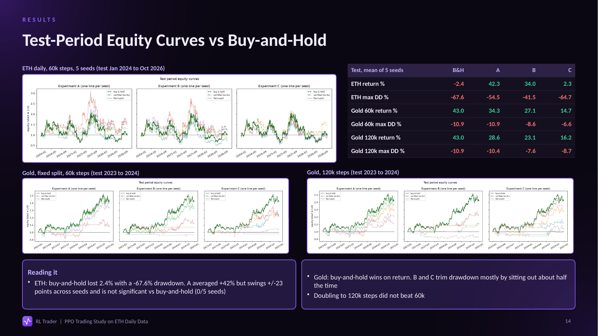

*Test-period equity curves compared with buy-and-hold (ETH daily and Gold).*

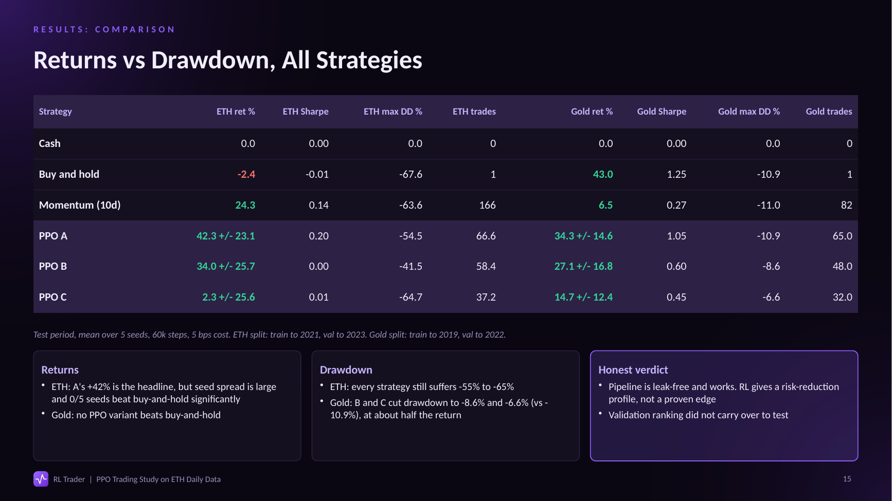

*Returns, Sharpe ratio and maximum drawdown for all strategies.*

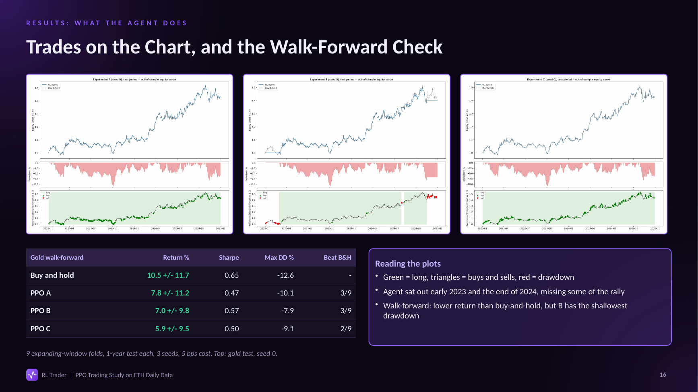

*Trades on the chart and the walk-forward check.*

---

# 16. Understanding Generated Files

The project generates several files during training and evaluation.

The following paths are useful when inspecting previous experiments.

| File or Folder | What to Inspect |
|---|---|
| `results/fixed_split/` | Fixed-split experiment outputs. |
| `results/fixed_split/runs.csv` | Individual run-level results. |
| `results/fixed_split/seed_summary.csv` | Seed-level performance summary. |
| `results/fixed_split/seed_action_history.csv` | Recorded action history. |
| `results/fixed_split/training_progress.csv` | Training progress information. |
| `results/fixed_split/summary_test.csv` | Final test comparison. |
| `results/fixed_split/summary_valid.csv` | Validation comparison. |
| `results/fixed_split/results_table.md` | Readable experiment summary. |
| `results/fixed_split/test_equity_curves.png` | Test equity curve comparison. |
| `results/fixed_split/backtest_A_seed0.png` | Experiment A backtest visualisation. |
| `results/fixed_split/backtest_B_seed0.png` | Experiment B backtest visualisation. |
| `results/fixed_split/backtest_C_seed0.png` | Experiment C backtest visualisation. |
| `results/walkforward/walkforward_runs.csv` | Individual walk-forward run results. |
| `results/walkforward/walkforward_per_fold.csv` | Results separated by fold. |
| `results/walkforward/walkforward_table.md` | Overall walk-forward summary. |
| `outputs_ppo_logger/action_log.csv` | PPO action logging. |
| `outputs_ppo_logger/training_updates.csv` | PPO training update logs. |
| `outputs_ppo_logger/run_metadata.json` | Logger run configuration. |

### Where to Find Trained Models

```text
models/fixed_split/selected/
models/5m_experiment/selected/
models/eth_daily_full/
models/training_120k/
```

### Where to Find Other Experiment Results

```text
results/5m_experiment/
results/eth_daily/
results/eth_daily_full/
results/seed_robustness_10/
results/training_120k/
results/walkforward/
results/walkforward_60k/
results/walkforward_B_only/
results/saved_model_evaluation/
results/tradebot/
```

These directories preserve outputs from different experiments, assets, timeframes and training configurations.

---

# 17. Application Walkthrough

The RL Trader dashboard (React + Vite frontend, FastAPI backend) follows the research workflow from the sidebar. It reads real local data and saved results only, and shows empty states instead of sample data.

## Dashboard

Overview of total return, Sharpe ratio, max drawdown and the number of discovered market data files, with shortcuts to the main workflow stages.

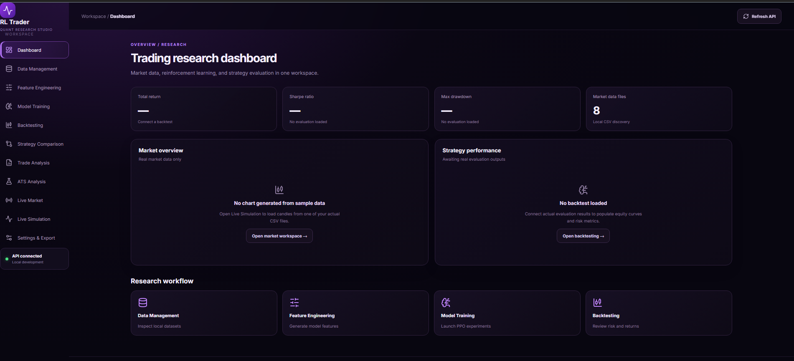

## Data Management

Lists the CSVs in the data directory and inspects a selected file: row count, missing values, duplicates, date range, columns and a preview of recent rows.


## Feature Engineering

Turns a raw price CSV into the feature table the agent trains and runs on. Raw features: `log_return` (required), `return_5d`, `return_10d`, `rolling_vol_10d`, `rsi_14`. Optional ATS-style features: `garch_cond_vol`, `regime_flag`, `momentum_signal`. Output is saved as `results/features_<source>.csv`, so datasets never overwrite each other. The feature selection must match what the model was trained on.


## Model Training

Launches `run_seed_selection.py` through FastAPI. Configure the feature CSV, train/validation end dates, timesteps, seeds, experiments (A: Raw, B: Raw + ATS, C: Guardrail), turnover penalty, and output/model folders. A training monitor shows status and backend logs. Start with 3,000 timesteps as a smoke test.


## Backtesting

Browser for everything saved under `results/`: charts, CSVs, markdown tables and JSON runs. Searchable, with preview and download.

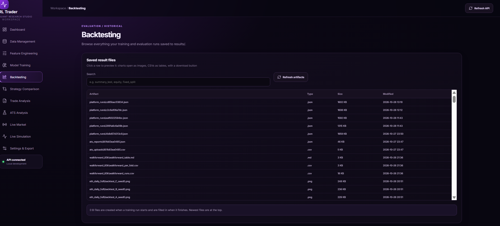

## Strategy Comparison

Compares PPO A/B/C against flat (cash), buy and hold, 10-day momentum and a volatility filter, using saved summary files. Metrics: return, Sharpe, max drawdown, Sortino, entries, total trades, time in market, cost drag, and significance vs buy-and-hold. Held-out test results are the fair scoreboard; validation is only for model selection.


*Use the experiment folder dropdown to switch between fixed-split and walk-forward runs, and compare only matching periods. The numbers shown come from the selected folder and can differ from the Gold results in Section 15.*

## Trade Analysis

Shows how the agent behaved: requested vs executed actions, actual entries/exits, redundant actions, long vs flat days and guardrail overrides, per experiment, seed and split. A model with thousands of requested actions but few entries mostly repeats itself, and a seed with almost no entries is nearly buy-and-hold or nearly flat.

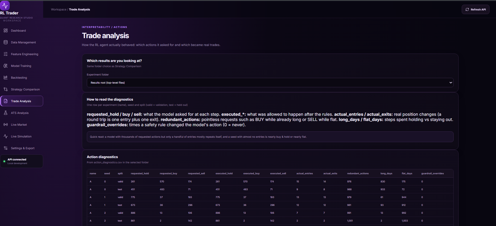

## ATS Analysis (Applied Time Series)

Upload a time-series CSV and run a full statistical analysis in the background. See [Section 18](#18-ats-module-applied-time-series) for the stages.


### Completed ATS Report

Progress through each stage, then summary metrics such as observations, the selected model (for example ARIMA(1,0,0)) and holdout RMSE/MAE.

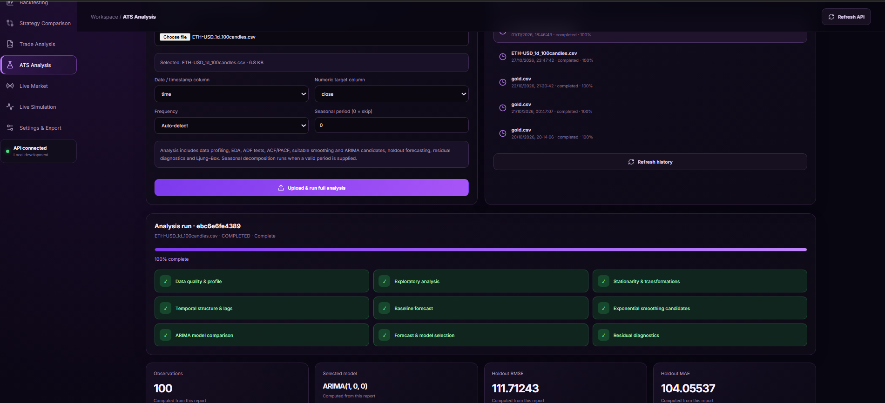

## Live Simulation

Historical replay with real candles. Choose the market CSV and the number of candles, view the candlestick chart with indicator overlays (SMA 20/50, RSI 14, MACD, Bollinger Bands, volume), then select a trained model with its expected feature dataset to replay its decisions.

The model dropdown lists only models trained for the selected kind of dataset, and the feature CSV must match the model's `metadata.json`. The signals depend on the selected dataset, the compatible model and the chosen window, so different windows can give anything from a single BUY to many round trips.


### BUY/SELL Signal Visualisation

The model's trades are drawn on the chart (▲ BUY, ▼ SELL) for the selected window. Hover a candle for its OHLC values and scroll sideways for earlier candles.

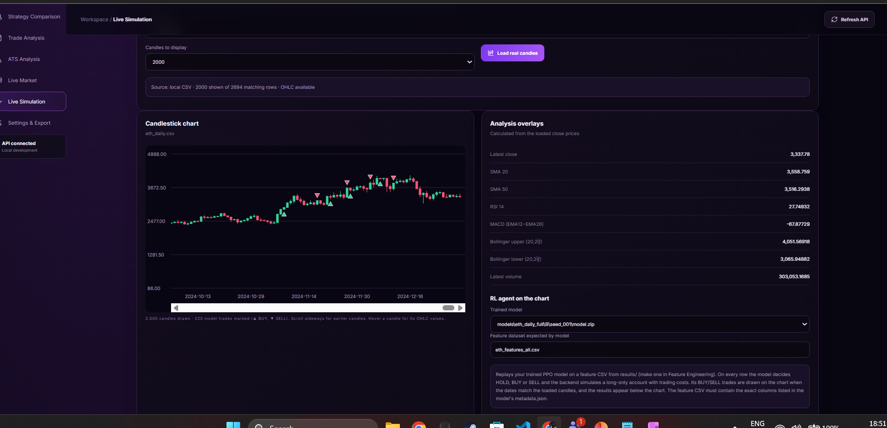

### Replay Results and Decision History

After **Run model on compatible historical data**, the page confirms the model artifact, scaler, metadata and compatibility check, then reports return, Sharpe ratio, max drawdown and executed trades. A chronological table lists each decision date with its action, position, reward, equity and drawdown.

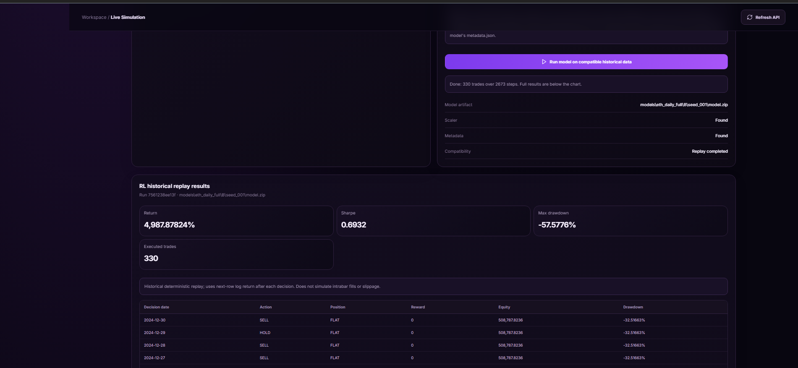

In this run (`models/eth_daily_full/B/seed_001/model.zip`) the replay covered 2,673 steps with 330 executed trades, a Sharpe ratio of 0.69 and a max drawdown of -57.58%.

> **How to read this return:** the replay runs over the full ETH daily history, which includes the period the model was trained on. The very large return is therefore an in-sample replay, not a held-out result. Use the test-period and walk-forward results in [Section 15](#15-experimental-results) to judge performance. The replay also uses the next-row log return after each decision and does not simulate intrabar fills or slippage.

> Live Simulation is a deterministic historical replay. It is not a live prediction and does not place real orders.

## Live Market

A market workspace for choosing an asset, a model trained for it and a timeframe (5m, 15m, 30m, 1h, 4h, 1d), with a candlestick chart of recent candles. The chart can be scrolled sideways, and the history and visible candle counts can be changed. The candles can also be downloaded as a CSV.

The **Model window** slider picks which stretch of candles is sent to the model. The **AI decision** panel then shows the model's action (BUY, HOLD or SELL), a confidence value, the signal price and candle, and a stop loss and take profit level. It also shows how the price has moved since the signal. **Analyze this window** re-runs the model on the selected window.

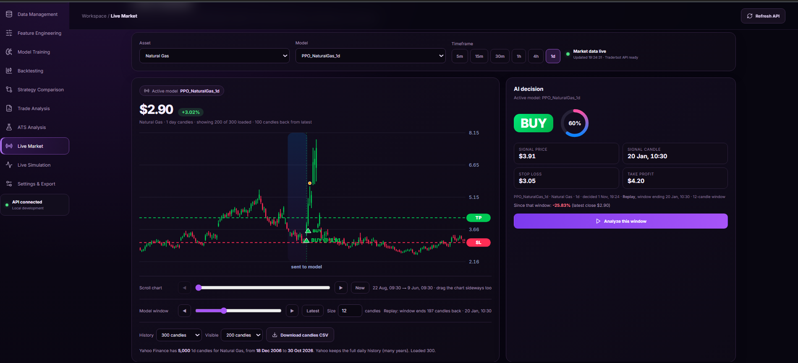

*Example: the `PPO_NaturalGas_1d` model on Natural Gas daily candles produced a BUY at $3.91 (60%) for a 12-candle window ending 20 Jan, with the price down 25.83% since that signal at the latest close of $2.90.*

> Live Market is a research and demonstration view. Signals come from historical or recently loaded market data, the stop loss and take profit levels are illustrative, and the app does not place real orders.

---

# 18. ATS Module (Applied Time Series)

The repository includes an Applied Time Series (ATS) analysis lab, available from the **ATS Analysis** page and through backend endpoints that run analyses and serve saved reports.

### Workflow

1. Upload a time-series CSV and choose the date column, numeric target column, frequency and optional seasonal period.
2. The backend queues the job and runs it in stages: data quality and profile, exploratory analysis, stationarity and transformations (ADF tests), temporal structure and lags (ACF/PACF), baseline forecast, exponential smoothing candidates, ARIMA model comparison, forecast and model selection, residual diagnostics (including Ljung-Box).
3. Seasonal decomposition runs when a valid period is supplied.
4. Progress is shown stage by stage.
5. Reports are saved and can be reopened from the Saved analyses list without recomputing.

### Example Output

For `ETH-USD_1d_100candles.csv` (100 observations) the lab selected **ARIMA(1, 0, 0)** and reported holdout RMSE and MAE (see the screenshot in [Section 17](#completed-ats-report)).

The ATS-style features used by RL experiment B (`garch_cond_vol`, `regime_flag`, `momentum_signal`) draw on the same time-series ideas, but `garch_cond_vol` is a rolling-volatility proxy rather than a fitted GARCH forecast.

---

# 19. Limitations and Future Improvements

Although the project implements a complete historical trading research workflow, several limitations remain.

### Current Limitations

1. Models can overfit historical market behaviour.
2. Market regimes can change.
3. Transaction costs and execution assumptions are simplified.
4. Results can vary significantly across random seeds.
5. Daily and intraday data can behave differently.
6. Repeatedly inspecting test results can introduce selection bias.
7. Historical results do not guarantee future performance.

### Future Improvements

- More comprehensive walk-forward reporting.
- Comparison with additional RL algorithms.
- Rolling-window training experiments.
- More realistic slippage and liquidity modelling.
- Evaluation on genuinely held-out recent market data.
- Additional risk controls.
- Paper trading before considering any live execution.

---

## Technologies Used

### Machine Learning and Quantitative Research
- Python
- Reinforcement Learning
- Proximal Policy Optimization (PPO)
- Stable-Baselines3
- NumPy
- Pandas
- Scikit-learn
- Matplotlib

### Backend
- Python
- FastAPI
- Uvicorn

### Frontend
- React
- Vite
- JavaScript
- CSS

### Development Tools
- Git
- GitHub
- Visual Studio Code

---

## 👤 Authors

- GitHub: [Dhruv Marwal](https://github.com/DhruvMarwal) , [Priyanshu Jha](https://github.com/Priyanshu0423) , [Shivang Jain](https://github.com/Xopse)
- LinkedIn: [Dhruv Marwal](https://linkedin.com/in/dhruvmarwal) , [Priyanshu Jha](https://linkedin.com/in/priyanshujha-) , [Shivang Jain](https://linkedin.com/in/shivang-jain-69602132a)

---

